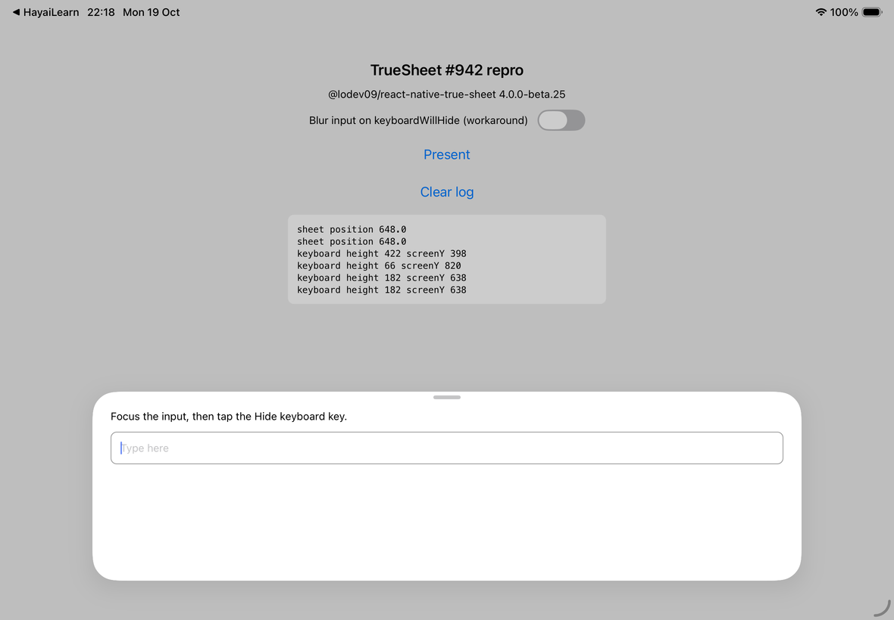

# TrueSheet #942 repro

Minimal reproduction for [lodev09/react-native-true-sheet#942](https://github.com/lodev09/react-native-true-sheet/issues/942).

On iPad, focus a `TextInput` inside an `auto` sheet, then tap the keyboard's **Hide keyboard** key. The sheet goes back to its height, then about 0.45 s later it grows again. A blank area stays under the input until the input loses focus.

The input keeps focus after **Hide keyboard**, so iPadOS shows its minimized keyboard (the small button in the bottom-right corner). iPadOS reports it as a keyboard frame (`height 182, screenY 638` in landscape), and the sheet grows for it.

## Environment

| | |
|---|---|
| `@lodev09/react-native-true-sheet` | `4.0.0-beta.25` |
| expo | `~57.0.24` |
| react-native | `0.86.3` (New Architecture) |
| react | `19.2.3` |
| Device | iPad (A16) simulator, iPadOS 26.4, landscape |

## Run

```sh
npm install
npx expo run:ios
```

Use the software keyboard: in the simulator, I/O → Keyboard → uncheck "Connect Hardware Keyboard".

1. Rotate the iPad to landscape.
2. Tap **Present**.
3. Tap the input. The keyboard rises and the sheet grows.
4. Tap the **Hide keyboard** key (bottom-right key on the iPad keyboard).
5. The sheet shrinks back, then grows again and keeps a blank gap below the input.

The log on the screen shows each `keyboardWillChangeFrame` event.

Turn on **Blur input on keyboardWillHide** to try the workaround from the issue. With it on, the input loses focus, iPadOS does not show the minimized keyboard, and the sheet keeps its height.

## Result

After step 5. The blank area is under the input, and the last keyboard frames come from the minimized keyboard:


